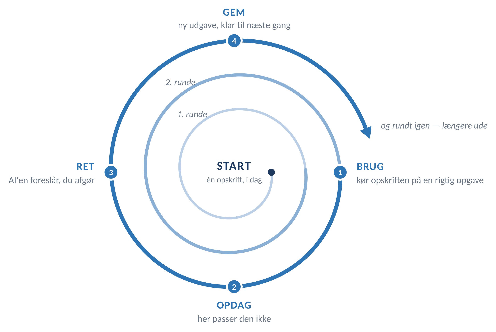

# Playbook — sådan virker den

Version 2.1 · generisk udgave · [ændringsnoter nederst](#ændringsnoter)

Det her er rammen om opskrifterne. Selve opskrifterne ligger i [OPSKRIFTER.md](OPSKRIFTER.md).

---

## Rekursiv læring

En rekursiv funktion har brug for tre ting: et sted at begynde, en hukommelse, og en regel, der kalder sig selv.

Det er præcis, hvad en playbook er.

Den starter med standardopskrifter for din branche, og AI'en hjælper dig med at skære ned til de to-tre, du skal bruge.

Så kører du én af dem. Den passer ikke helt. Du retter den.

Rettelsen er hukommelsen. Næste runde begynder derfra.

Rekursion lyder som noget, AI gør ved sig selv. Her gør du det.

Maskinen glemmer alt mellem hver samtale. Din fil, `min-playbook.md`, er der, hvor det, du lærte, bliver liggende: AI'en skriver den ud efter hver rettelse, og du giver den tilbage i næste samtale.



Fire skridt, der gentager sig. Den inderste bane er din første runde, hvor du endnu ikke ved, hvad du skal kigge efter. Jo længere ud, jo mere dækker hver omgang — fordi opskriften, prompten og du selv har flyttet jer.

---

## FERC — sådan arbejder du sammen med AI'en

Den hyppigste fejl er at behandle AI'en som en automat: man skriver én prompt, får ét svar, synes det er middelmådigt og konkluderer, at værktøjet ikke dur. FERC er en måde at gøre det til en samtale i stedet — fire trin, hvor du hele tiden har hånden på rattet.

| Trin | Hvad du gør | Eksempel på, hvad du skriver |
|---|---|---|
| **Frame** | Giv AI'en rollen, opgaven, materialet og formatet. Det er præcis det, starter-prompten i hver opskrift gør for dig — derfor er den så lang. | Starter-prompten i opskriften. Du udfylder kun pladsholderne. |
| **Explore** | Bed om flere muligheder, før du vælger. Og bed AI'en sige, hvad den selv er i tvivl om — det er dér, fejlene plejer at være. | *"Giv mig tre forskellige udkast med hver sin vinkel — og sig, hvad du er mest usikker på."* |
| **Refine** | Giv feedback i små skridt i stedet for at skrive hele prompten om. Sig hvad der er tæt på, og hvad der skal ændres. | *"Nummer to er tættest på. Gør den kortere, og fjern fagsproget i afsnit 2."* |
| **Commit** | Du vælger, retter og sender. AI'en må støtte arbejdet — det er dig, der står på mål for det. | Ingen prompt. Du læser igennem, tjekker alle [TJEK]-markeringer og tager ansvaret. |

**Hvorfor det virker.** Modellen lærer ikke af dig — den får bare mere at arbejde med. Det første svar er sjældent det bedste, ikke fordi værktøjet er dårligt, men fordi det ikke kender din opgave endnu. Hver gang du siger "tættere på" eller "ikke sådan", snævrer du opgaven ind. Derfor er tre korte beskeder næsten altid bedre end én lang og perfekt. Bemærk: det nulstilles, når du åbner en ny samtale.

**Hvis du kun husker én ting:** Stop ikke ved det første svar. Spørg *"hvad er du i tvivl om?"* og *"giv mig to andre måder"* — det tager tyve sekunder og er oftest forskellen på et brugbart og et ubrugeligt resultat.

> FERC (Frame · Explore · Refine · Commit) er udviklet på Center for Hybrid Intelligence, Aarhus Universitet, og er frit tilgængeligt: [hi-infinity.ai/ferc](https://hi-infinity.ai/ferc/). Tak til Jacob Aagaard for at pege os i den retning.

---

## Sådan skriver du til mig

FERC handler om, hvordan I arbejder sammen. Det her handler om, hvordan svaret ser ud, når det lander hos dig.

Det er den instruktion, der betaler sig hurtigst. Den gælder hver eneste opskrift, og den tager tredive sekunder at give.

Giv AI'en denne blok i starten af samtalen — eller læg den i værktøjets faste instruktioner, hvis det har sådan et felt.

```
SÅDAN SKRIVER DU TIL MIG

1. Svar først. Konklusionen i første linje. Begrundelsen bagefter.
2. Selvbærende. Hver besked bærer det, den skal bruge. Sig hvad en ting er,
   ikke hvor den blev sagt: "stopreglen (tre år under indeks)" - ikke
   "stopreglen fra i mandags".
3. Én ting ad gangen. Ét spørgsmål pr. besked. Vent på mit svar.
4. Eksempel før regel. Vis ét konkret tilfælde med rigtige tal og navne,
   før du generaliserer.
5. Almindelige ord. Forklar et fagudtryk, første gang det optræder - også
   hvis du forklarede det tidligere i samtalen.
6. Sig hvad du er usikker på. Markér det. Fyld ikke hullet ud.
```

**Før og efter**

| Uden reglen | Med reglen |
|---|---|
| "Som nævnt i afsnit 5 ligger Type I-raten i den øvre ende på 32–46 % efter ti år." | "Efter ti år: mellem 32 og 46 %. Det er Type I — varianten, hvor kunden selv betaler gebyret. Afsnit 5 har de øvrige." |

**Gør den til din.** De seks regler er et udgangspunkt, ikke en facitliste. Tilføj dine egne, efterhånden som du opdager, hvad der irriterer dig:

> *"Jeg læser tabeller bedre end prosa."*
> *"Skriv aldrig mere end en skærmfuld ad gangen."*
> *"Jeg husker ikke forkortelser — skriv dem ud hver gang."*
> *"Henvis aldrig til noget tidligere i samtalen. Gentag det i stedet."*

Det er samme loop som alt det andet. Hver gang et svar er svært at læse, siger du hvorfor, og reglen får en linje mere. Efter et par uger er den din — og den er sandsynligvis den del af playbooken, du får mest ud af.

---

## Spilleregler — før du bruger den på rigtigt arbejde

Opskrifterne kan køres i dag på dine egne notater, interne skabeloner og offentligt materiale. Men før kunde- eller klientmateriale går ind i et AI-værktøj, er der nogle ting, der skal være på plads. Det er ikke bureaukrati — det er dét, der gør, at du trygt kan bruge resultatet.

### Adgangsbilletten: fire svar på skrift fra den dataansvarlige

Det tager vedkommende fem minutter at svare, og du er dækket ind resten af vejen. Spørg om:

1. Er værktøjet godkendt til arbejdsmateriale hos os — og i hvilken tilstand?
2. Er der databehandleraftale, og hvor behandles og lagres data?
3. Hvor længe gemmes samtalerne, og kan de udleveres ved en senere gennemgang?
4. Har vi kunder, aftaler eller opgavetyper, hvor brug af AI er aftalt fra?

**Indtil du har svarene:** kør opskrifterne på materiale, du selv har skrevet, på interne skabeloner eller på offentligt tilgængeligt materiale. Det er rigeligt til at vurdere, om en opskrift har værdi.

### Én samtale = én kunde

Bland aldrig materiale fra flere kunder i samme samtale. Du må bruge din egen viden fra en tidligere opgave, men du må ikke lægge kunde A's dokumenter ind for at løse kunde B's opgave — heller ikke som "reference". Skal du sammenligne, så brug offentligt materiale eller noget, du har afidentificeret så grundigt, at hverken parter, beløb, branche eller forløb kan henføres. Luk samtalen, når opgaven er løst.

### Tre ting, der er lette at overse

- **Alt bliver gemt.** Det, du skriver, og det, AI'en svarer, ligger i firmaets systemer på linje med dine mails og kan indgå i en senere gennemgang. Skriv ikke noget til AI'en, du ikke ville skrive i en mail.
- **Fortrolighedsmærkater forsvinder, når du kopierer.** Er et dokument mærket, mister den kopierede tekst mærkatet — og den kontrol, der skulle have fanget det. Vedhæft filen i stedet.
- **Anonymisering er ikke at fjerne navne.** En opgave med to parter, en branche og et beløb er stadig identificerbar i et lille marked.

### De fem ting, du ikke bruger den til

Afgørelse af et fagligt tvivlsspørgsmål · beregning af frister og deadlines, du ikke selv efterprøver · angivelse af gældende regler, uden at du selv slår op · noget, du ikke har tid til at læse grundigt igennem · opgaver, hvor kunden har frabedt sig tredjepartsværktøjer.

**Og den vigtigste:** alt, der forlader huset, er læst, rettet og godkendt af dig. AI'en laver et udkast, ikke en kollega med ansvar. Den gætter, hvis den mangler grundlag — derfor beder alle prompter den om at skrive `[TJEK]` eller `[IKKE FUNDET]` i stedet for at fylde hullet ud.

---

## Hvilket værktøj, og hvad du kan uden licens

Der findes flere produkter, der hedder noget med AI-assistent, og de kan ikke det samme. Tjek, at du er logget på med din arbejdskonto, ikke en privat.

- **Chat med arbejdskonto, uden tilkøbt licens.** Du kan skrive til den og vedhæfte eller indsætte materiale. **Alle opskrifter kan køres sådan** — netop fordi de er bygget på, at du selv leverer konteksten.
- **Chat med tilkøbt licens.** Her kan assistenten selv søge i husets filer og mails. Valget mellem "arbejde" og "web" bestemmer, *hvad den må kigge i* — ikke om dine data er beskyttede; det gør din arbejdskonto.
- **Knapperne inde i tekstbehandling, mail og mødeværktøj** (opsummer, udkast, mødeoversigt) kræver som regel den tilkøbte licens. Har du dem ikke, bruger du chatten i stedet. Du mister ikke casen — kun nogle klik.

### Når du kopierer tekst ind i stedet for at vedhæfte

Vedhæftning er den sikre vej. Kan du ikke det, kopierer du teksten — men vær opmærksom på fire ting, der ikke følger med:

- **Lange tekster bliver klippet af, uden at du får besked.** Indsæt ét dokument ad gangen, og bed altid AI'en bekræfte: *"Gengiv første og sidste linje af det, du modtog."*
- **Tabeller** flades ud, så kolonnerne smelter sammen — og AI'en gætter resten uden at sige det.
- **Fodnoter, sidehoved og sidefod** kommer ikke med. Derfor beder opskrifterne om afsnits- eller punktnummer og aldrig om sidetal: sidetal findes ikke i indsat tekst, og AI'en vil finde på dem.
- **Ændringsmarkeringer** følger med, hvis de vises. Slå dem fra først, ellers læser AI'en også det, der er streget ud. Scannede dokumenter giver slet ingen tekst.

---

## Sådan dokumenterer du værdien

Lav en simpel log og udfyld en linje, hver gang du bruger en opskrift — også de gange, det gik galt. Det er de mislykkede kørsler, der gør tallene troværdige.

**Start med en baseline, du ikke selv har gættet.** Træk din egen registrerede tid på de valgte opgavetyper for de seneste seks måneder ud af det system, I bruger. Det er rigtige tal, og de findes allerede. Et bagudrettet skøn fra den, der gerne vil vise, at det virker, holder ikke fem sekunder i en ledelse. Brug sagsnummer og ikke kundenavn i loggen — den ligger uden for jeres systemer.

| Dato | Opskrift | Opgave (kort) | Tid med AI | Baseline (registreret) | Fakturerbar? | Brugbart udkast? | Hvad jeg rettede |
|---|---|---|---|---|---|---|---|
| | | | | | | | |

**Hold fakturerbart og ikke-fakturerbart adskilt.** Hvis I sælger timer, er en sparet fakturerbar time ikke uden videre en gevinst. Den rigtige gevinst ligger tre steder: arbejde på fastpris, hvor sparet tid går direkte på bundlinjen; opgaver du i dag ikke når; og kortere gennemløbstid, som kunden faktisk mærker.

**Aftal også, hvad der får jer til at stoppe.** Skriv tre succeskriterier og tre stopkriterier ned, før du går i gang, og få dem godkendt. For eksempel: *"mindst 2 af 4 opskrifter giver et brugbart førsteudkast i 4 ud af 5 kørsler"* — og *"hvis kontroltiden overstiger den sparede tid i 3 af 4 opskrifter, stopper vi"*. Uden stopkriterier er konklusionen skrevet på forhånd, og så er forsøget ikke et forsøg.

**Den bedste case er ikke den, hvor AI'en var perfekt.** Det er den, hvor du kan sige: *"Det tog 8 minutter i stedet for 25, jeg rettede to formuleringer, og den fangede noget, jeg havde overset."* Gem 5-10 konkrete før/efter-eksempler — ét eksempel, folk kan læse, overbeviser bedre end en tidstabel.

**To ting, der ellers bliver glemt:** Kontrol og parallelkørsel er intern, ikke-fakturerbar tid — aftal et loft, før du går i gang, og log timerne i samme log. Og opdager du en AI-afledt fejl i noget, der allerede er sendt ud, meldes den ad husets almindelige vej for fejl i en opgave, ikke som et it-spørgsmål.

---

## Ændringsnoter

Tabellen her er rammens egen log — ændringer i denne playbook. Dine egne ændringsnoter står nederst i `min-playbook.md`, og dem fører din AI: hver gang den retter en opskrift, giver den dig hele filen igen med nyt versionsnummer og en ny linje. Du gemmer den oven i den gamle — eller AI'en gør det selv, hvis den kan skrive filer.

| Version | Dato | Hvad er ændret | Hvorfor |
|---|---|---|---|
| 2.0 | | Generisk udgave | Udgangspunkt. |
| 2.1 | 2026-11-12 | Din fil hedder `min-playbook.md`, og AI'en giver dig hele filen efter hver rettelse | Så det, du lærte, ikke går tabt mellem samtaler. Navnet undgår forveksling med PLAYBOOK.md på Windows og macOS. |

**Når listen i din `min-playbook.md` har 10-15 linjer:** Kig den igennem med din AI og spørg: *"Hvilke af disse ændringer handler om, at jeg selv skulle finde og indsætte materiale? Og hvilke handler om, at værktøjet gjorde noget andet, end jeg forventede?"*

Den første bunke er dit argument for integrationer — det er dér, et rigtigt AI-setup ville fjerne arbejde, du udfører i hånden i dag. Den anden bunke er bare noget, der skulle læres. Den skelnen er svær at lave bagefter, men nem, når ændringsnoterne står der.
