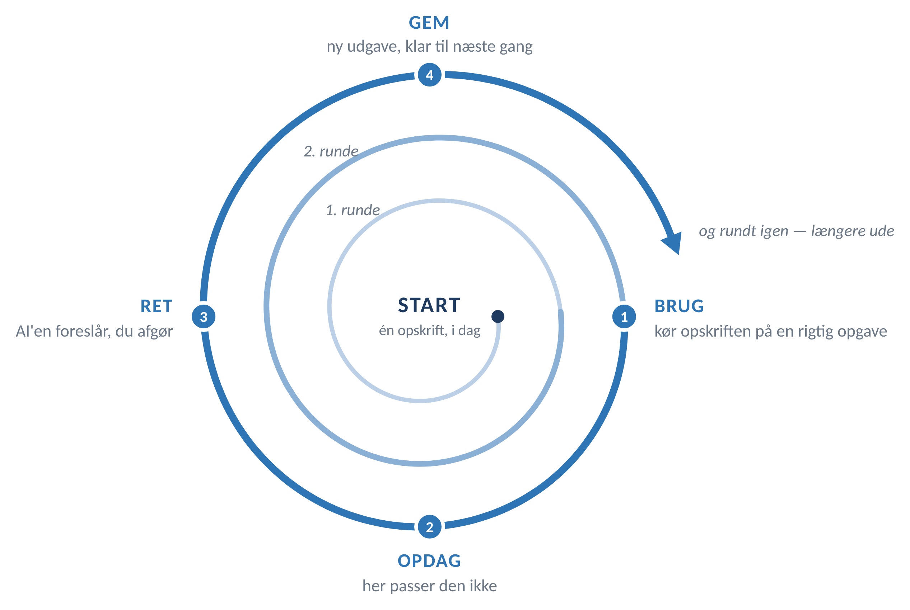

# playbook-loop

**Du lærer hurtigst, når sidste runde er med i den næste.**

En rekursiv funktion har brug for tre ting: et sted at begynde, en hukommelse, og en regel, der kalder sig selv.

Det er præcis, hvad en playbook er.

---

## Sådan starter du

Giv din AI denne ene sætning:

> Læs https://github.com/mbuchvardt/playbook-loop/blob/main/START.md og følg den.

Så spørger den, hvad du arbejder med, skriver de 15 opskrifter om til dit fag, og hjælper dig med at vælge de tre, du skal starte med.

Ti minutter senere har du din egen playbook, version 1.0.

## Hvad der sker derefter

Du kører en opskrift på en rigtig opgave. Den passer ikke helt. Du beder om en rettelse, AI'en foreslår, du afgør — og gemmer den nye udgave.

Næste runde begynder derfra.

Rekursion lyder som noget, AI gør ved sig selv. Her gør du det. Maskinen glemmer alt mellem hver samtale; playbooken er der, hvor det, du lærte, bliver liggende.

## Hvad ligger her

| Fil | Hvad det er |
|---|---|
| [START.md](START.md) | Bootstrap-prompten. Den, du peger din AI på. |
| [PLAYBOOK.md](PLAYBOOK.md) | Hvordan loopet virker, hvordan du får AI'en til at skrive, så du kan læse det, spillereglerne, og hvordan du måler, om det giver værdi. |
| [OPSKRIFTER.md](OPSKRIFTER.md) | 15 opskrifter på konkrete arbejdsopgaver. |

## Opskrifterne er med vilje allerede udfyldte

De 15 opskrifter er skrevet med eksempler fra et advokatfirma. Det er ikke, fordi playbooken er til jurister — det er, fordi en tom skabelon er svær at komme i gang med, og et færdigt eksempel er let at skrive om.

Eksemplerne er pladsholdere. I runde 1 skriver din AI dem om til din branche og dine opgaver, og så er advokaten væk.

Det er samme princip som resten: du starter fra noget, der allerede findes, og gør det til dit.

## Hvis din AI ikke kan hente en URL

Nogle værktøjer kan ikke åbne links. Så åbner du selv [START.md](START.md), markerer hele filen, kopierer den og sætter den ind i chatten. Samme resultat, ét klik mere.

Det samme gælder de andre filer: kan AI'en ikke hente dem, indsætter du dem som tekst, én ad gangen.

## Et ord om fortrolighed

Playbooken beder dig aldrig om at sende noget ud af huset. Men den kan ikke vide, hvad der gælder hos jer.

Kør den i det AI-værktøj, din arbejdsplads har godkendt, og hold kunde- og klientoplysninger ude, indtil nogen med ansvaret har sagt god for det. [PLAYBOOK.md](PLAYBOOK.md) har fire spørgsmål, du kan stille den dataansvarlige, og tre opskrifter, du kan køre imens uden at spørge nogen om lov.

## Rekursion på to niveauer

Din playbook bliver bedre, når du retter den.

Denne her bliver bedre, når du sender rettelsen tilbage. Fandt du en opskrift, der manglede, en prompt, der gav et dårligt svar, eller en formulering, der var forkert — så åbn et issue eller en pull request. Ændringsnoterne nederst i PLAYBOOK.md er det fælles loop.

## Licens

[CC BY 4.0](LICENSE). Brug den, ret den, del den videre — bare med kreditering.
